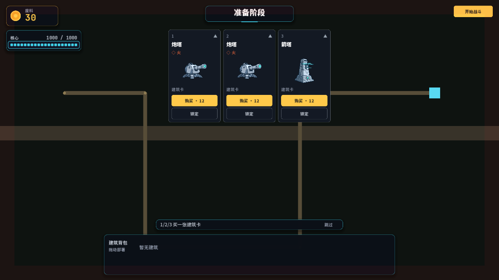

# 守核 Corebound

[](https://github.com/w814929152/corebound/actions/workflows/ci.yml)

**围绕核心建造防线，用卡牌组合抵御来自四周的怪物。**

守核是一款开发中的肉鸽塔防与卡牌构筑游戏，面向 PC，使用 **Godot 4.7.2** 开发。玩家从裂隙航图选择关卡和卡包，在波间购买建筑、部署防御塔，再主动开启下一波。守住核心并完成关卡要求的波数即可通关。

## 当前版本

截至 **2026-11-10**，已提交的主要内容：

- **10 个关卡**：各有异形地形、障碍、入口与波表，每关 10–20 波。
- **8 个卡包、82 张建筑卡**：每局最多选择 3 包，形成 30–32 张建筑卡池；可用包不足 3 个时使用全部可用包。
- **卡包主题卡面**：八包各有独立场景背景与主题色基座，商店、图鉴和背包统一显示，建筑主体保持清晰。
- **自由部署与升级**：在可建区域拖放建筑，同原型落在同格可升级，建筑上限为 10 座。
- **战术战斗**：防御塔按实际射程攻击，怪物可持续攻击塔与核心；支持物理、魔法、真实伤害及多种状态效果。
- **中文界面与卡名**：菜单、图鉴、卡包、商店、背包和详情共用名称来源。
- **居中竖版商店**：三张卡牌并排展示，移除外层底板与工具栏，停留卡面后显示详情。
- **镜头导航与退出确认**：默认 200% 近景，支持平移、缩放和总览；退出关卡前暂停并确认。



*已提交商店版本的运行截图；此图用于展示卡牌布局。*

## 开始游戏

1. 安装 **Godot 4.7.2**，克隆仓库。
2. 用 Godot 导入仓库根目录的 `project.godot`，等待资源导入完成。
3. 运行项目，从主菜单进入裂隙航图，选择已解锁的关卡和卡包。
4. 开局只有核心和 **30 废料**。购买建筑卡，将底部背包里的建筑拖到地图上，点击“开始战斗”。

也可使用命令行启动：

```bash
git clone https://github.com/w814929152/corebound.git
cd corebound
godot --editor --path .
godot --path .
```

命令中的 `godot` 需替换为本机引擎可执行文件路径，或先将引擎加入 PATH。

## 操作

| 操作 | 方式 |
|---|---|
| 选择关卡 | 点击航图节点，或 `←` / `→` 移动焦点、`Enter` 选择 |
| 航图返回主菜单 | `Esc` |
| 打开 / 收起商店 | `Tab` |
| 购买商品 | 点击购买，或商店打开时按 `1` / `2` / `3` |
| 刷新商店 | 商店打开时按 `R`，消耗废料 |
| 锁定商品 | 点击卡面“锁定”；商店打开时 `Space` 切换当前焦点商品的锁定 |
| 部署建筑 | 从底部建筑背包拖放到可建格子 |
| 取消放置 / 收起商店 | `Esc` |
| 开始战斗 / 下一波 | 点击右上方对应按钮 |
| 平移战场 | 拖动空地或按住鼠标中键拖动 |
| 准备阶段移位 | 拖拽已部署防御塔到合法空地；基地固定，Esc 取消 |
| 缩放 / 总览 | 滚轮或导航按钮；“总览”查看全图 |
| 回到核心 | `F` 或“回到核心”，恢复默认 200% 近景 |
| 退出当前关卡 | 点击“退出关卡”，确认返回航图；`Esc` 或“继续游戏”取消 |

主动放弃不结算本局奖励，永久解锁进度保留；重新挑战会重建本局构筑。

每次进入准备阶段，全部防御塔复活并恢复满血，基地也恢复满血；可免费调整防御塔位置，战斗开始后不可移位。

## 卡包与关卡进度

当前玩家商店**只出售建筑卡**。强化卡、经济卡的历史实现保留在工程中，未加入当前玩家卡包。

| 卡包 | 建筑数 | 主要机制 |
|---|---:|---|
| 泛用包 | 10 | 经济、赏金、物理类型转换 |
| 熔炉包 | 11 | 灼烧、火焰充能、登场升级 |
| 霜序包 | 11 | 冰冻、减速、整备升级 |
| 穿甲包 | 10 | 贯穿、流血、阵亡升级 |
| 电弧包 | 10 | 弹射、减速、击杀升级 |
| 破甲包 | 10 | 削物抗、流血、攻防光环 |
| 咒术包 | 10 | 削魔抗、易伤、持续伤害 |
| 湮灭包 | 10 | 真实伤害、召唤、觉醒 |

泛用包常驻；已守地区的科技永久解锁，当前地区原生卡包可在本关借用。通关与失败按规则结算余烬，主动退出不结算。再来一局会先返回航图，可重新选择关卡和卡包。

建筑只能部署在可建格子，障碍、核心禁建区和地图外不可落子。同原型同格叠层升级；不同原型不能覆盖已有建筑。放置时显示六边形网格，取消后建筑仍保留在背包中。

完整内容见 [卡牌图鉴](docs/phase6/card-catalog.md)、[卡包设计](docs/phase6/card-packs.md) 和 [关卡推进](docs/phase6/world-map.md)。

## 开发与验证

在项目根目录运行，首次使用前先导入资源：

```bash
# 导入资源
godot --headless --path . --import

# 默认完整回归（包含 world 12 套检查）
godot --headless --path . --script res://tests/run_tests.gd

# 关卡、商店、放置、镜头和退出关卡
godot --headless --path . --script res://tests/run_tests.gd -- world

# UI 样式 / 塔身贴图资产守卫
godot --headless --path . --script res://tests/run_tests.gd -- uistyle
godot --headless --path . --script res://tests/run_tests.gd -- towersprites

# 径向战斗与消耗战门禁
godot --headless --path . --script res://tests/run_tests.gd -- radial8
```

2026-11-10 本地验证：默认完整回归退出码 **0**；随后补跑 world **12/12 PASS（16.3 秒）**。这是本地验收记录，GitHub Actions 当前状态以上方徽章及 [工作流运行记录](https://github.com/w814929152/corebound/actions) 为准。

已知限制：

- `radial8` 的 `attrition8` 有历史平衡断言失败，见 [交接记录](docs/phase6/handoff-2026-11-09.md)；本轮未修复或复跑该组，未降低阈值。
- Godot 退出时仍有 ObjectDB、RID 和资源未释放警告。
- 10 塔上限及结构攻击参数仍需进一步整局平衡验证。
- 仓库不包含 Windows 成品包；本地旧构建可能落后于源码。

数值与模拟代码维护约定见 [工程控制清单](docs/architecture/control-manifest.md)。玩家路线和金标本模拟器有独立的开关与验证路径，请勿为通过测试随意修改数值或阈值。

## 导出 Windows 版本

安装与引擎版本一致的 Godot 导出模板后，使用已有的 Windows Desktop 预设：

```bash
godot --headless --path . --export-release "Windows Desktop" build/windows/Corebound.exe
```

产物为内嵌 PCK 的可执行文件。`build/` 与可执行文件不进入 Git，具体步骤见 [打包说明](docs/phase6/demo-build.md)。

## 工程结构与文档

| 路径 | 内容 |
|---|---|
| `scripts/engine/` | 伤害、战斗循环与金标本模拟 |
| `scripts/gameplay/` | 刷怪、商店运行时与玩法接线 |
| `scripts/geo/` | 空间模型与建造网格 |
| `scripts/data/` | 建筑、卡包、地图、关卡与波表数据 |
| `scripts/ui/` | 战场、HUD、商店与菜单 |
| `art/`、`assets/` | 游戏美术、字体等资源 |
| `tests/`、`tools/` | 回归检查、资源生成与预览工具 |
| `docs/`、`design/` | 架构、验收记录和设计规范 |

- [最新功能交接](docs/phase6/handoff-2026-11-10-gameplay.md)
- [商店布局与操作](docs/phase6/shop-ui-2026-11-10.md)
- [退出关卡](docs/phase6/stage-exit.md)
- [UI 样式](docs/phase6/ui-polish.md)
- [自由部署](docs/phase6/free-placement.md)
- [战场与地形](docs/phase6/battlefield-redesign.md)
- [怪物攻击建筑](docs/phase6/monster-structure-attacks.md)
- [程序化塔身贴图](design/art/tower-sprites-v2.md)
- [代理开发入口](AGENTS.md)
