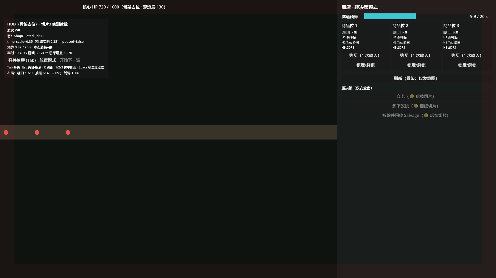

# Phase 3 · 切片3：实时商店覆盖层 — 架构 + Godot 4.7.2 API 调研 + 可运行骨架 验证报告

- **作者**：程基岩（工程主理人）
- **引擎**：Godot `v4.7.2.stable.official.ed1daf0bf`
- **判据**：`design/gdd/shop-reroll.md` **v1.2 定稿**（v1.1 §2.1 五态时钟口径总表 · §2.2/§5.2 减速预算 · §2.4 C3 双焦点 · §1.3 五条红线；v1.2 回写 Q-S3-A/B/C 三项拍板）§3.1 常量表
- **结论**：🟢 **全部 5 条验收标准达成**，切片1/2 的既有断言零回归
  - 切片3 自测 **142 项 / 0 失败**（含 Q-S3-A 推论 8 项 + Q-S3-C 工程配置/布局 7 项）
  - 切片3 场景冒烟 **25 项 / 0 失败**（真机帧循环，含 10 实时秒预算实测 + 1920 布局 4 项）
  - 全量回归 **222 + 2228 + 142 全过，退出码 0**
- **架构文档（主交付）**：`docs/architecture/slice3-shop-ui-architecture.md`
  - ✅ **3 项待拍板（Q-S3-A/B/C）均已于 2026-10-01 拍板并落地**，见 §5.1 拍板结果

---

## 1. 验收标准逐条对照

### ① 场景能在 Godot 4.7.2 里跑起来 ✅

```bash
GODOT="/c/Users/junhewang/Downloads/Godot_v4.7.2-stable_win64.exe/Godot_v4.7.2-stable_win64_console.exe"

"$GODOT" --headless --path D:/roguedemo --quit         # EXIT=0
"$GODOT" --path D:/roguedemo                            # 窗口模式，骨架可见（见 §4 截图）
```

| 跑法 | 退出码 | 说明 |
|---|---|---|
| `--headless --quit` | **0** | `boot.gd` 跑 切片1(222) + 切片3(142) 自测后退出 |
| `--headless --script res://tests/run_tests.gd` | **0** | 全量 222 + 2228 + 142 |
| `--headless --script res://tests/run_slice3_scene_smoke.gd` | **0** | 真实帧冒烟 |
| `--path D:/roguedemo`（窗口） | **0** | 骨架可见，并截帧 |

### ② 五态切换 `time_scale` / `paused` 与 GDD §2.1 逐条一致 ✅

真机实测（`docs/phase3/slice3-scene-smoke.log`，W8 非新手波）：

| 态 | 期望 ts | 期望 paused | **实测 ts** | **实测 paused** | 预算消耗 | 抽屉 | 预算剩余 |
|---|---|---|---|---|---|---|---|
| ① Combat | 1.00 | false | **1.00** | **false** | 否 | 0 关闭 | 20.00 |
| ② ShopDilated | 0.35 | false | **0.35** | **false** | 是 | 1 轻决策 | 19.96 |
| ⑤ PlacementMode | 0.25 | false | **0.25** | **false** | 是 | 0 🔴 收起 | 19.92 |
| ② ShopDilated（回） | 0.35 | false | **0.35** | **false** | 是 | 1 | 19.88 |
| ③ ShopRealTime | 1.00 | false | **1.00** | **false** | 否（已耗尽） | 1 🔴 不强制关 | 0.00 |
| ① Combat（回） | 1.00 | false | **1.00** | **false** | 否 | 0 | 0.00 |
| ④ SafeWindow | 1.00 | 🔴 true | **1.00** | **true** | 否 | 2 重决策 | 0.00 |

> 🔴 **SR-R5 双保险**：④ 的 `time_scale` 保持 `1.00`（不是 0），世界靠 `paused=true` 停；
> 单元自测另跑了 **6 个波次 × 5 个态 = 30 组**，`time_scale` 恒 > 0；代码里还有 `assert(ts > 0.0)`。

**暂停真的停**：进入 ④ 后跑 30 帧，战场占位节点的游戏时间 `0.251612 → 0.251612`（**完全静止**，PAUSABLE 生效）。

### ③ 减速预算用 unscaled 计时，按实时秒正确消耗 ✅

```
验收标准 3：开商店 10 实时秒 → 预算 20 → 10
  实时经过 = 10.005 s（unscaled，Time.get_ticks_msec 差值）
  战场推进 = 3.502 s（scaled，Σdelta）     ← 10.005 × 0.35 = 3.502 ✅
  预算消耗 = 10.005 s
  预算剩余 = 9.940 / 20 s                  ← 20 − 10.005 = 9.995，差 0.055s（首帧对齐误差）
  思考增益 = ×2.86（实时 / 游戏）           ← 与 GDD §5.2 的 "2.86×" 一致
```

窗口模式复跑（vsync 60fps）：`实时 9.999 s / 战场 3.500 s / 预算耗 9.999 s / 剩 9.993 / ×2.86`。

**新手保护**：W3 打开商店 `ts=0.25`、跑 40 帧后预算仍 `20.00`（不消耗）。

### ④ headless 自测退出码 0，不破坏切片1/2 的 2228 断言 ✅

```
$ "$GODOT" --headless --path D:/roguedemo --script res://tests/run_tests.gd
919:  汇总：通过 222 项 / 失败 0 项        ← 切片1（原样）
1001: 汇总：通过 2228 项 / 失败 0 项       ← 切片2（原样，含 MC 300 局）
1146: 汇总：通过 142 项 / 失败 0 项        ← 切片3（129 + 拍板落地新增 13）
EXIT=0
```

完整输出：`docs/phase3/slice3-full-run.log`。

### ⑤ 架构文档说明后续切片要接什么 ✅

`docs/architecture/slice3-shop-ui-architecture.md` §8 列了 **I-1 ~ I-10** 十个接口点
（wave-spawner 的 WS-1/WS-2/WS-4/WS-5、商店意图信号、C2 高亮、拆除结算器、SubViewport、二次确认弹窗、音频）。

---

## 2. Godot 4.7.2 API 调研结论（详见架构文档 §7）

> 程基岩训练数据只到 4.3。以下结论**全部在本机 4.7.2 上实测**，
> 证据：`docs/phase3/slice3-godot47-api-probe.log`（探针 `tools/probe_godot47.gd`）。

| # | 发现 | 等级 | 影响 |
|---|---|---|---|
| 1 | `_process(delta)` 的 delta **被 `time_scale` 缩放**（`Σdelta/Σ真实秒` = 1.006 / **0.3500** / **0.2500**） | ✅ 与 GDD §5.2 口径一致 | `delta / time_scale` = 真实秒，公式成立 |
| 2 | 🔴 **`Engine` 类在 4.7.2 没有 `get_process_delta_time()`**（ClassDB 枚举确认） | 🔴 改变实现 | unscaled 计时**只能**用 `Time.get_ticks_msec()` |
| 3 | `time_scale = 0` 时 `delta` 恒为 **0** → `δ/ts = 0/0 = **NaN**`（`is_nan` 实测 true），`Time` 仍在走 | 🔴 SR-R5 的物理证据 | 安全窗绝不能用 `time_scale=0`；`Time` 差值不受影响 |
| 4 | 暂停 200 帧：`PAUSABLE` 子节点 `_process` **0 次**；`ALWAYS` 节点 200 次 | ✅ | 安全窗下商店可交互成立 |
| 5 | 暂停期间 **`_unhandled_key_input` 仍被 `ALWAYS` 节点收到**（1 次 TAB → 命中 1 次） | ✅ | GDD 交接点 2 成立 |
| 6 | 🔴 **`Node.accept_event()` 在 4.7.2 不存在**（编译报错实测） | 🔴 4.3→4.7 差异 | 改用 `get_viewport().set_input_as_handled()` |
| 7 | 🔴 **直接赋值 `anchors_preset` 静默失效**（`anchor_right` 仍 0.0）；`set_anchors_preset()` / `set_anchor()` 才有效 | 🔴 4.7 已知坑 | 所有锚点在脚本里设，`.tscn` 不写 anchors |
| 8 | `Side` 枚举是**全局常量**（`SIDE_RIGHT=2`），写 `Control.SIDE_RIGHT` 会编译报错 | 🟡 | — |
| 9 | 容器排序：⏳ 1280 时代调研 HBox(1248) = 战场 676 + sep 12 + 抽屉 560；✅ Q-S3-C 落地后 1920 实测 **ShopOverlay = 614.4×1080**（探针 `tools/probe_layout_1920.gd`） | ✅ | 布局算尺与引擎行为一致 |
| 10 | `SceneTree.create_timer(…, ignore_time_scale)` / `Tween.set_ignore_time_scale(true)` 都在 | ✅ | 红光脉冲正式实现可用 |
| 11 | `Engine.time_scale` **不影响**音频播放速度（官方文档明示） | ✅ | 交接点 9（UI 音效不受减速影响）**自动满足** |
| 12 | 4.7 新建项目默认 stretch 改 `canvas_items` + `expand`；本工程未设 `aspect` | 🟡 | 建议显式钉死（见 §4 工程建议） |
| 13 | `Control.offset_transform_*` 是 4.7 新增（4.3 没有） | ℹ️ | 抽屉滑入动画可考虑 |

**未发现**任何与 `time_scale` / `paused` / `process_mode` / `CanvasLayer` / `Time` 相关的破坏性变更 —— 这几块 4.3→4.7 稳定。

---

## 3. 切片3 自测清单（142 项，`tests/test_suite_slice3.gd`）

| 段 | 内容 | 项数 |
|---|---|---|
| 1 | 五态时钟口径总表（W6）：ts / paused / 是否耗预算 / 抽屉，5 态 × 4 项 | 20 |
| 2 | 🔴 SR-R5：6 波次 × 5 态 = 30 组 `time_scale > 0` | 30 |
| 3 | 预算 unscaled：10s→20→10、耗尽转③不关店、③冻结不变负、④冻结、⑤复用同池、E3 预算 0 仍可开店、E3 剩 0.5s 仍减速、🔴 3.8 Q-S3-A（⑤ 预算 0 → 等效 1.0× / 不耗预算 / 抽屉收起 / 立即退 ⑤ 落 ③） | 27 |
| 4 | 新手保护 W1–W5：0.25× 且不消耗；W6 恢复 0.35× | 22 |
| 5 | 思考时间增益 20×0.35=7 → ×2.857 | 2 |
| 6 | 显式转换表：8 条合法路径 + 5 条非法路径被拒 + ④ 里收/开抽屉 + ⑤ 原路返回 | 19 |
| 7 | 波次重置：预算回满、抽屉保持上次开/关 | 6 |
| 8 | C3 布局算尺：🔴 8.1 工程配置（1920×1080 + aspect=expand）、8.2 基准屏 1920（614.4 / 32% / 1305.6 / 68%）、8.3 非基准屏安全网（1280/1000/3840） | 13 |
| 9 | 🔴 C-3/SR-R2：商店源码正文 grep「推荐/最优/best/recommend/suggest」零命中（自动剥注释） | 3 |
| | **合计** | **142** |

**取整口径（Q-S3-C 落地时钉死）**：`shop_layout.gd` 返回**浮点原值**（614.4 / 1305.6，不 floor 不 round），直接交给 `Control.offset`（引擎按 float32 存储，探针显示 614.400024414063 属 float32 表示误差，非算尺误差）与 Node2D 绘制坐标。

**单元测试不依赖帧**：被测对象是零副作用的 `scripts/engine/time_state_machine.gd`，直接注入实时秒 → headless 下确定性可复现。真实帧的证据由场景冒烟补齐。

---

## 4. 截图（窗口模式，ShopDilated @0.35×，抽屉展开 · 1920×1080）

`docs/phase3/slice3-skeleton.png`（Q-S3-C 落地后重截，PNG 实测 1920×1080）



肉眼可验的 6 件事：

1. **双焦点布局**：右侧抽屉 **614.4px（32.0%）**，左侧战场 **1305.6px（68.0%）**，战场被压暗 —— 与 GDD §2.4「614px / 68-32」完全吻合（Q-S3-C 拍板落地）；HUD 读数面板同步显示 `布局：视口 1920 · 抽屉 614 (32.0%) · 战场 1306`；
2. **🔴 穿透式核心 HP 条**：顶部横跨整屏，**压在抽屉之上**（层 130 > 100）—— 唯一豁免遮挡规则的元素；
3. **三个商品位尺寸/配色/字号完全一致**（X3 合规：无布局暗示推荐）；
4. **减速预算条常驻可见**，显示 `9.9 / 20 s`；
5. **重决策入口（弃卡/卸下改投/拆除回收）在战斗中置灰**（T-C1 / E16）；
6. **边缘红光脉冲**四边可见（层 120，unscaled 相位）。

HUD 读数面板同时显示：`态: ShopDilated (id=1)` / `time_scale=0.35（引擎实测 0.35）` / `paused=false` / `预算 9.97/20`。
> ℹ️ 面板上的「思考增益 ×2.70」是**从场景启动起的累计值**（含 1.0× 的 Combat 帧），所以低于单次测量的 ×2.86；冒烟日志里的增量测量才是验收口径。

---

## 5. 待主理人拍板（3 项）

| # | 事项 | 本实现的选择 | 为什么必须问 |
|---|---|---|---|
| **Q-S3-A** | 预算在**放置模式（⑤）**耗尽的处置（GDD 未定义） | 立即退出放置 → 落 ③ 全速；卡退回队列（不销毁不退款） | 另一条路（继续 0.25×）会变成**免费无限慢动作**，预算失去货币属性 —— 这是设计取舍不是工程细节 |
| **Q-S3-B** | 单帧计入预算的实时秒上限 | `MAX_FRAME_REAL_DT = 0.25`（超过视为没在玩） | 🔴 **这是一个新数值，不在 GDD §3.1 常量表里**，按纪律必须上报 |
| **Q-S3-C** | 🔴 1280 视口下「32% 比例」与「最小宽 560px」顶牛 | 取 `max()` → 抽屉 43.75% / 战场 56.25% | **真实冲突，不是浮点噪声**。三条出路（提视口到 1920 / 接受 43.75% / 放宽下限）影响面不同，我的建议是①把视口提到 1920×1080（GDD 基准屏），但那改 `project.godot` |

次级推定（已按 GDD 推定，若与理解不符请指出）：③ 也能进放置模式；④ 里手动收起抽屉后下一波保持关。

### 5.1 ✅ 拍板结果（主理人 2026-10-01，GDD 已升 v1.2 回写）

| # | 拍板 | 落地位置 | 本轮改动 |
|---|---|---|---|
| **Q-S3-A** | ⑤ 放置模式预算耗尽 → **立即退出落 ③ 全速**，卡退回队列（不销毁不退款）；**推论：预算为 0 时进入 ⑤ 不得再减速（等效 1.0×）**（GDD §2.1 易错口径第 4 条） | `scripts/engine/time_state_machine.gd` | 检查结论：原 `tick()` 的「耗尽退 ⑤ 落 ③」**已符合拍板**；推论部分为**新修** —— 原 `clock()` 的 ⑤ 分支在预算 0 时仍返回 `0.25×`（`enter_placement()` 那一帧会先写入慢动作）。现改为：`is_budget_drained()` 时 ⑤ 返回 `1.0× / 不耗预算 / 抽屉仍收起`，`tick()` 开头对「预算 0 仍在 ⑤」立即退出。补断言：自测 §3.8 共 8 项 |
| **Q-S3-B** | `MAX_FRAME_REAL_DT = 0.25` 采纳（GDD §3.1） | `scripts/engine/mvp_config.gd`（已回写）/ `time_director.gd`（已按此实现） | **零改动**，只补进 control-manifest §1 口径冻结清单 |
| **Q-S3-C** | 🔴 视口 **1280×720 → 1920×1080**（GDD 基准屏：0.32×1920 = 614.4 与「614px / 32%」吻合）；`maxf` 算尺保留作非基准屏安全网 | `project.godot`（视口 + `stretch/aspect="expand"` 显式钉死）· `shop_layout.gd`（注释，算尺逻辑**未动**）· `battlefield_placeholder.gd`（默认视口占位值）· 自测 §8 / 冒烟布局断言 · 重截图 | 见 §1/§3/§4；1920 真实像素实测：`tools/probe_layout_1920.gd` → `docs/phase3/slice3-layout-1920-probe.log`（ShopOverlay = **614.4×1080**） |

🔴 **遗留歧义（Q-S3-A 衍生，已上报未擅改）**：**从 ④ SafeWindow 进入 ⑤** 时预算耗尽 → 本实现按 §2.1 图注「⑤ 原路返回」回 **④**（世界继续暂停）；但拍板文字「落 ③ 全速」按字面与世界暂停矛盾 —— 两条 GDD 条文对这一窄路径各说一词，**非浮点噪声**，等主理人澄清后若需改只动 `tick()`/`exit_placement()` 的回落目标一处。

## 6. 工程建议（不阻塞）

1. ✅ `project.godot` 显式加 `window/stretch/aspect="expand"` —— **已随 Q-S3-C 落地**（连同视口 1920×1080 一起钉死）。
2. `tools/probe_godot47.gd` / `tools/introspect47.gd` 保留为一次性调研工具（不进自测、不进产品）；以后引擎升级先重跑探针。（Q-S3-C 落地时新增同类探针 `tools/probe_layout_1920.gd`。）
3. ✅ control-manifest §8 证据索引补入切片3 条目 —— **已完成**（§1 冻结清单同轮补入 `MAX_FRAME_REAL_DT` 与视口两条定稿值）。

## 7. 证据与产物索引

| 产物 | 路径 |
|---|---|
| 架构文档（主交付） | `docs/architecture/slice3-shop-ui-architecture.md` |
| 切片3 自测套件 | `tests/test_suite_slice3.gd`（142 项） |
| 切片3 场景冒烟 | `tests/run_slice3_scene_smoke.gd`（25 项） |
| 1920 布局探针（Q-S3-C） | `tools/probe_layout_1920.gd` / `docs/phase3/slice3-layout-1920-probe.log` |
| API 探针 | `tools/probe_godot47.gd` / `tools/introspect47.gd` |
| API 实测日志 | `docs/phase3/slice3-godot47-api-probe.log` |
| 场景冒烟日志 | `docs/phase3/slice3-scene-smoke.log` |
| 全量回归日志 | `docs/phase3/slice3-full-run.log` |
| 骨架截图 | `docs/phase3/slice3-skeleton.png` |
| 五态时钟纯逻辑 | `scripts/engine/time_state_machine.gd` |
| 时钟适配层 | `scripts/ui/time_director.gd` |
| 布局算尺 | `scripts/ui/shop_layout.gd` |
| 骨架场景 | `scenes/battle_shop.tscn` |
