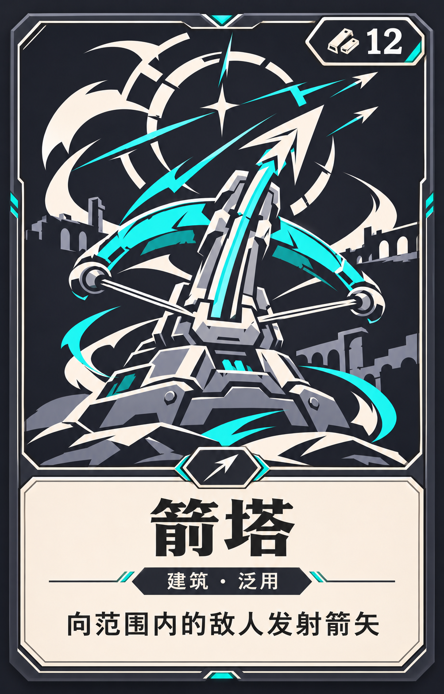

# 箭塔卡面实装说明

以商店的 **210 × 340 px** 卡槽为基准。卡框用深石墨色和浅色切角细线，青色点缀呼应箭塔插画。下方用暖白底和深色字，保证缩小后也能读到卡名和效果。

| 区域 | 建议布局 |
| --- | --- |
| 插画 | 上方约 70%，裁切限制在卡框内。直接用[游戏原插画](../../art/2d/cards/card_arrow_illustration_v2.png)，以弩身和箭头为裁切焦点。 |
| 费用 | 右上角放深色角标，废料图标在左、数字在右，数字建议 22–24 px。概念图里的 12 是展示值。 |
| 信息区 | 下方约 30%，左右各留约 12 px。卡名 26–28 px 加粗，居中放置。下一行放 13–14 px 类型标签，最下方放 13–14 px 的效果摘要，长文案最多两行。 |
| 分隔 | 插画与信息区之间放小型箭头徽记。徽记可以替换为其他卡牌的类别图标，且不占卡名和描述的空间。 |

从[商店卡槽布局 `_make_slot()`](../../scripts/ui/shop_overlay.gd)接入卡框、插画、费用角标和信息区。在[商店刷新逻辑 `_refresh_shop()`](../../scripts/ui/shop_overlay.gd)填充卡牌数据。卡名和效果摘要沿用 [card_text.gd](../../scripts/data/card_text.gd)，费用取商店快照的 `prices[i]`。图上的「建筑 · 泛用」和「向范围内的敌人发射箭矢」用于演示排版。正式实现时，类型取卡牌标签，卡包名如需展示则单独从卡包数据读取。

卡框与信息区作为界面层，插画用纹理节点，文字和价格用独立控件。锁定入口可移到左上角，为右上角费用留出空间。用原尺寸检查箭塔、长卡名和两行摘要各一张，并确认锁定、整卡购买和悬停详情正常。
